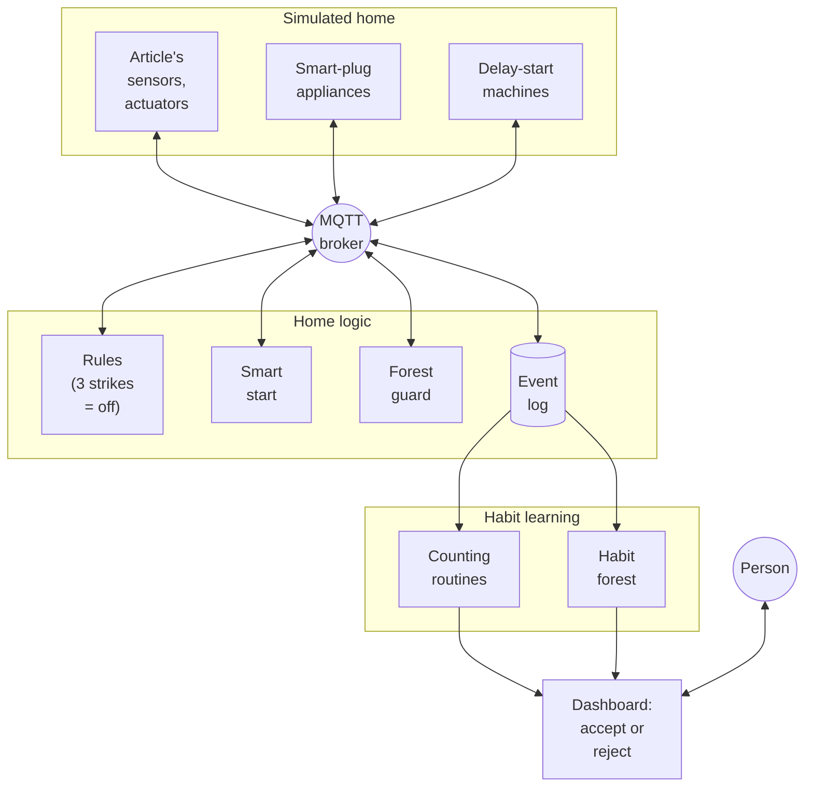
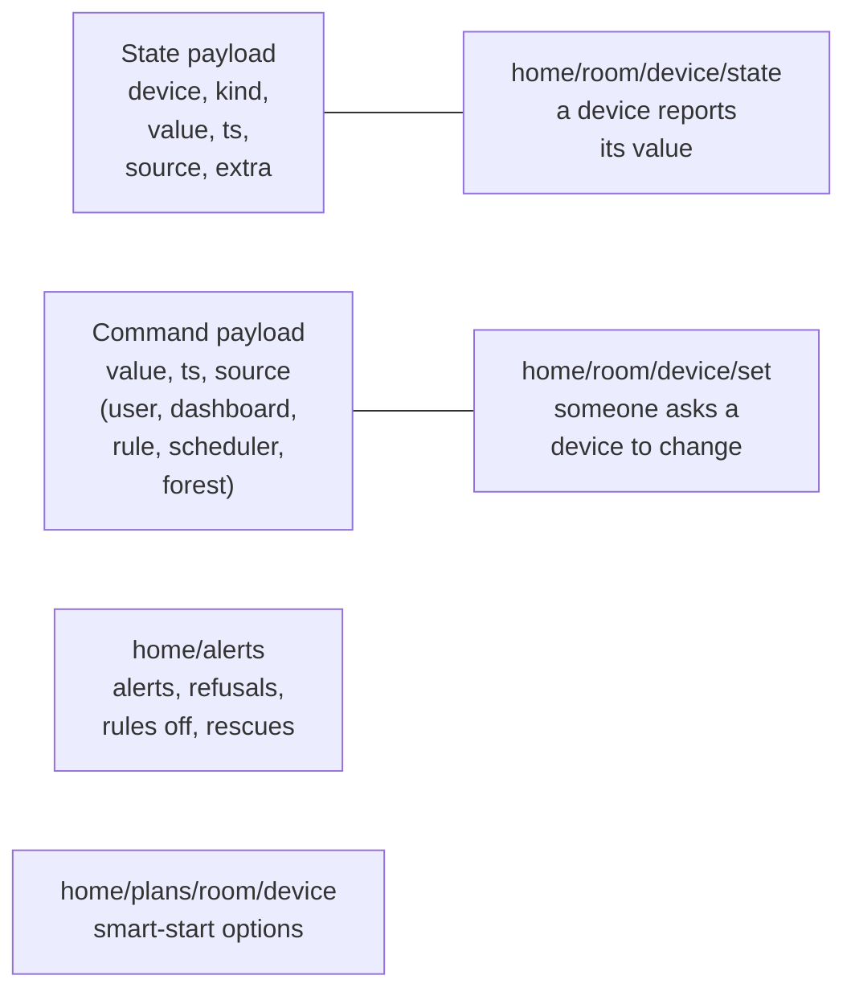
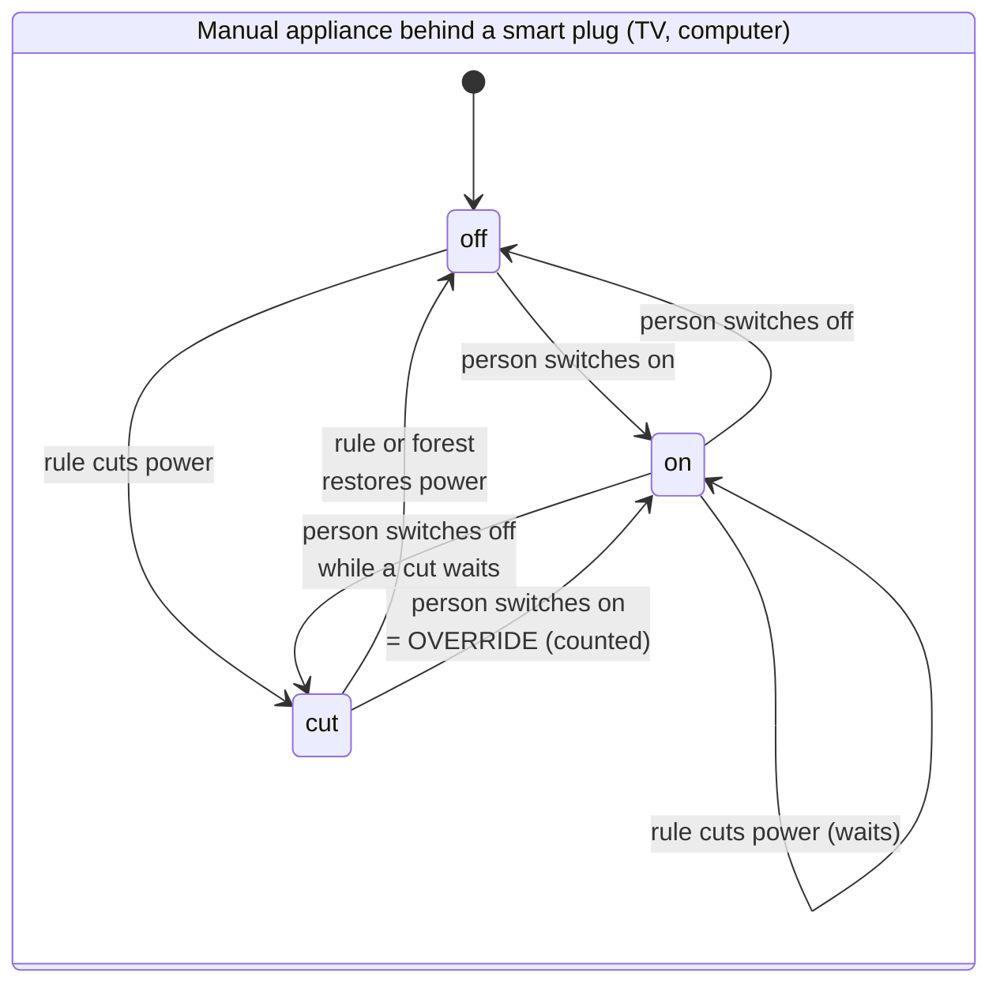
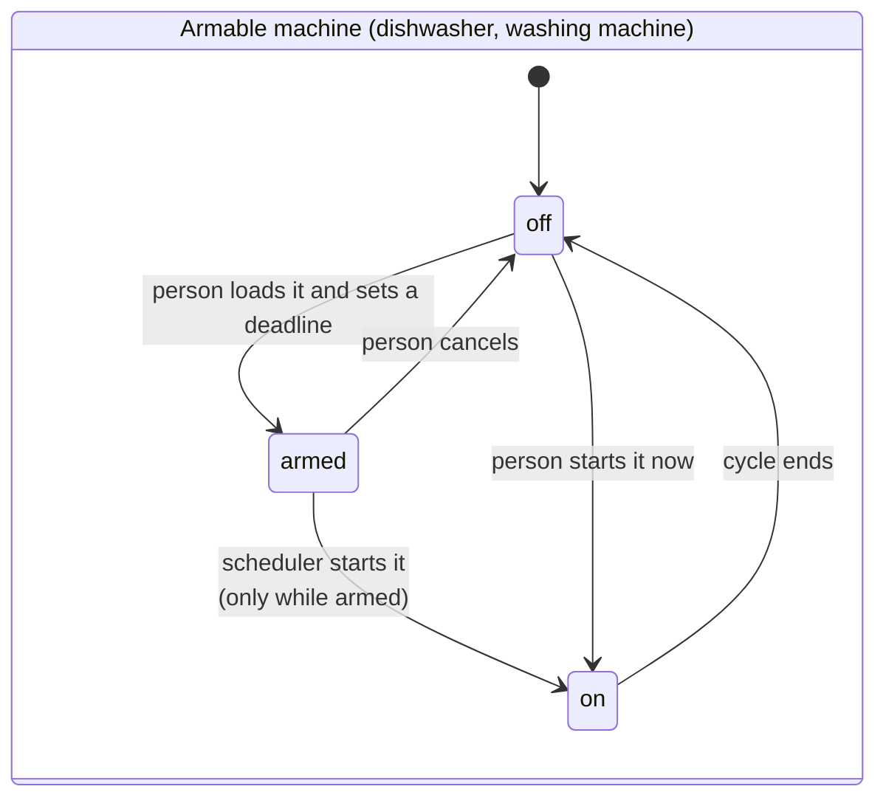
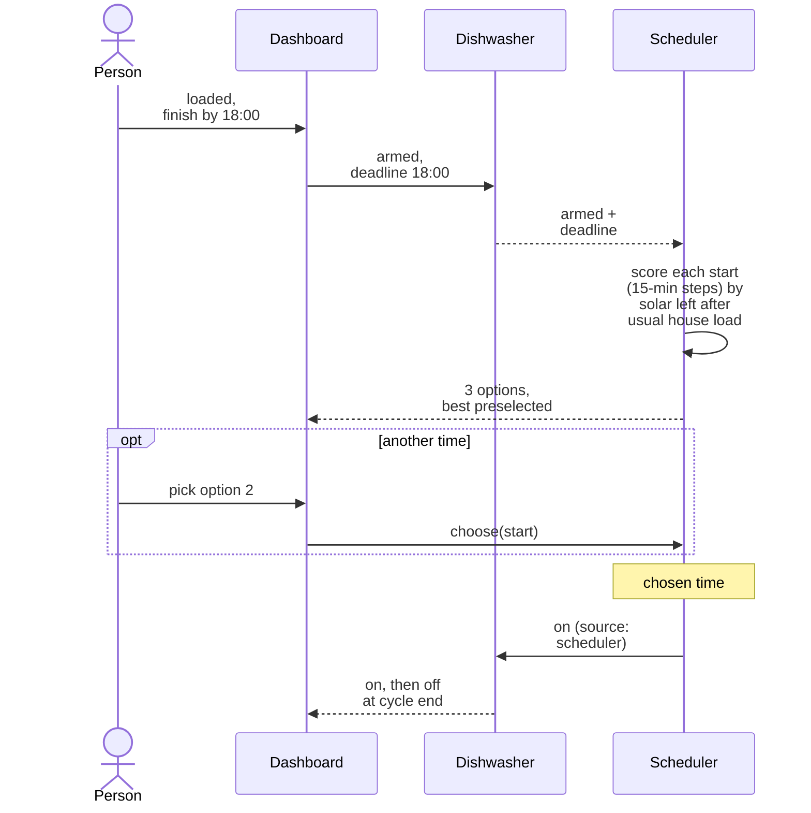
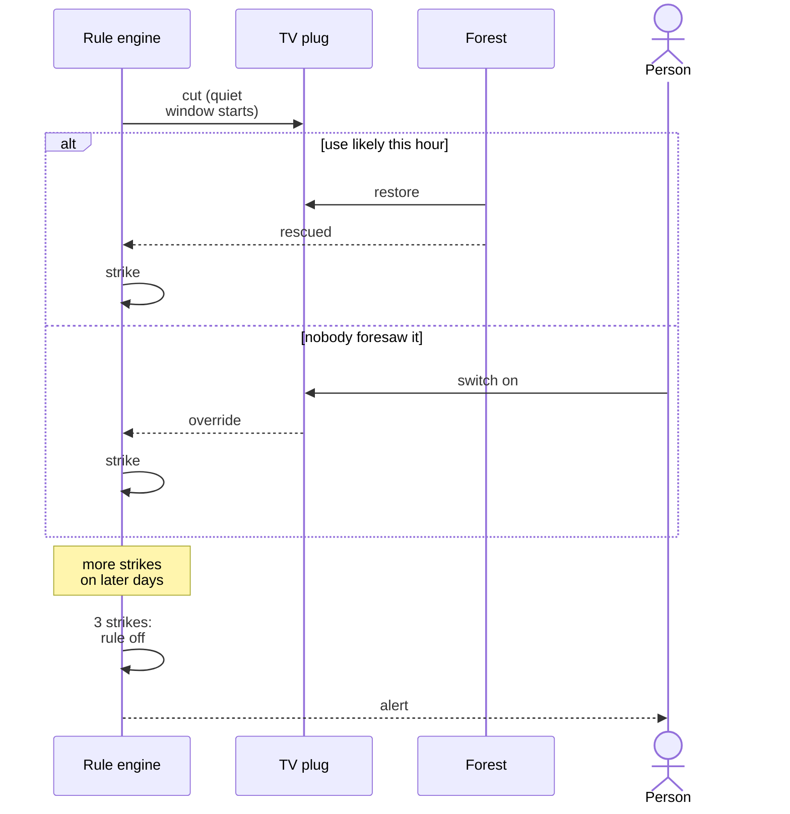
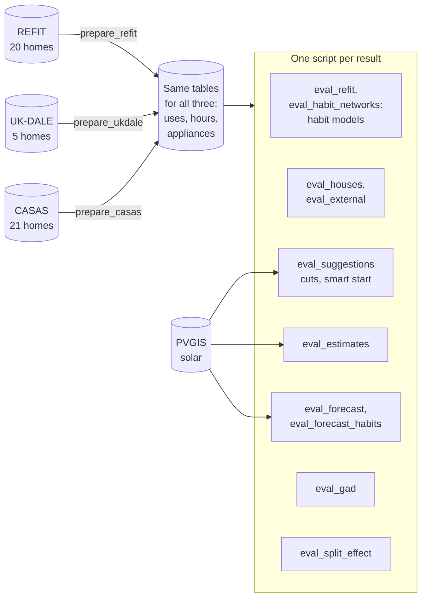
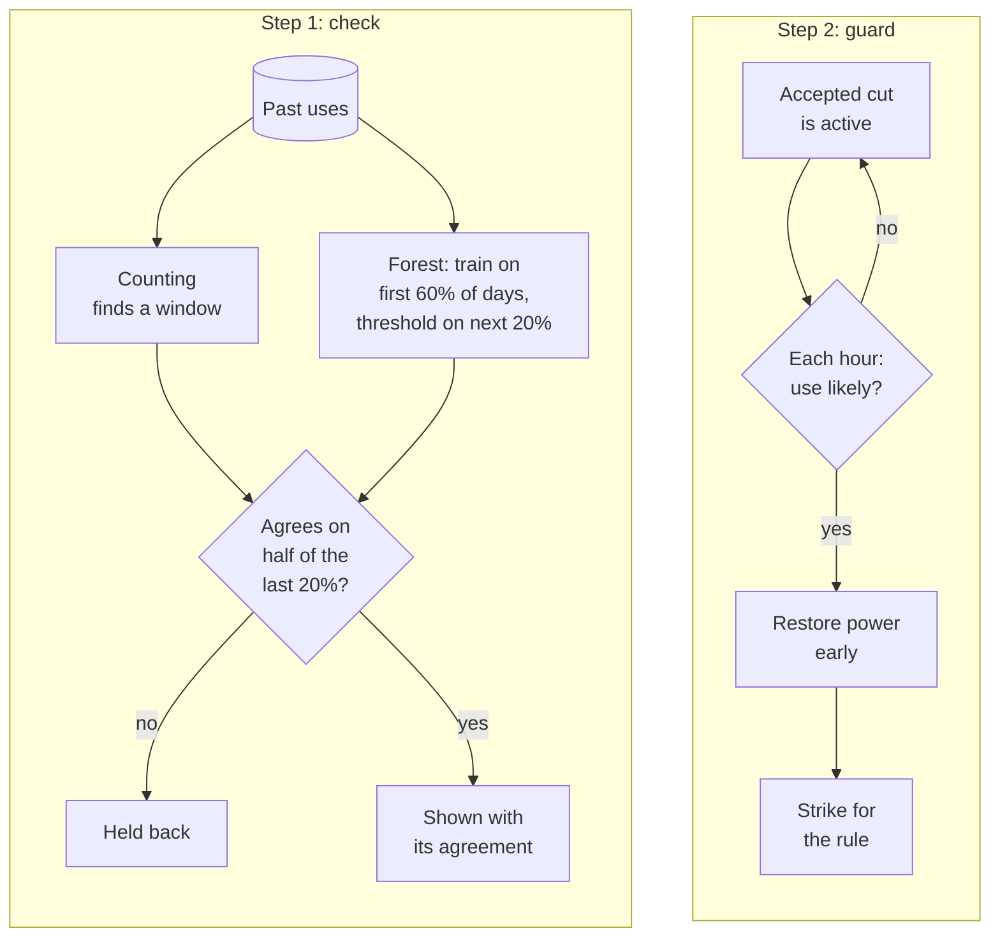

# Design diagrams

Mermaid diagrams for the report. They render on GitHub and in most Markdown
viewers. `scripts/render_diagrams.py` turns each block into a PNG in
`docs/figures/` (Mermaid in a headless Edge or Chrome, no install).

## 1. System architecture

Everything talks over one local MQTT broker. The article's devices and the
household's appliances are simulated; a real device would publish on the same
topics.

## 2. Topics and messages

## 3. What a rule may do to each kind of device

People can always operate a device. Commands from rules and the scheduler are
checked by the device itself.

## 4. Smart start (hybrid design)

## 5. Learning from being wrong

A strike is a person's override, or a cut the habit forest ended early because
it expected a use (the rule was about to be wrong).

## 6. Data and evaluation pipeline

Every reported number comes from one `eval_*` script, run on the prepared
tables of one dataset (`CAPSTONE_DATASET` = refit, ukdale or casas).

## 7. The habit forest in the loop

Counting proposes, the forest checks and guards (`habits/forest.py`).

